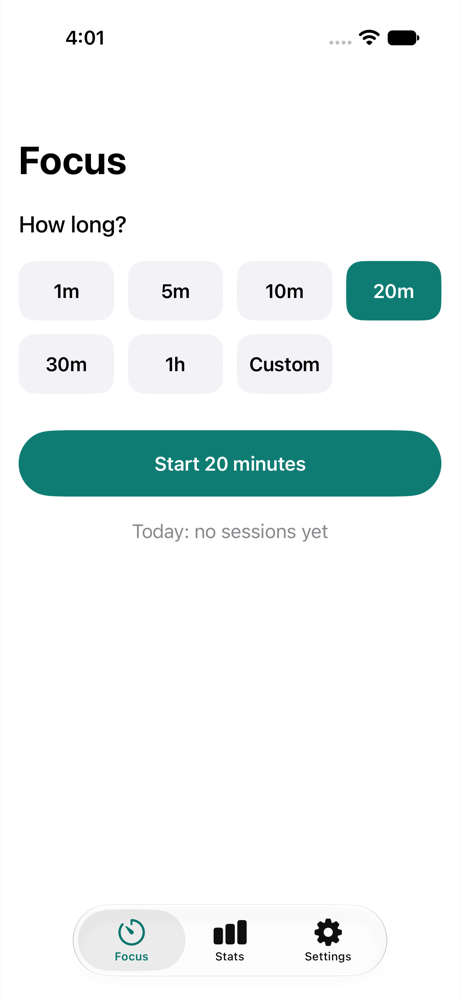
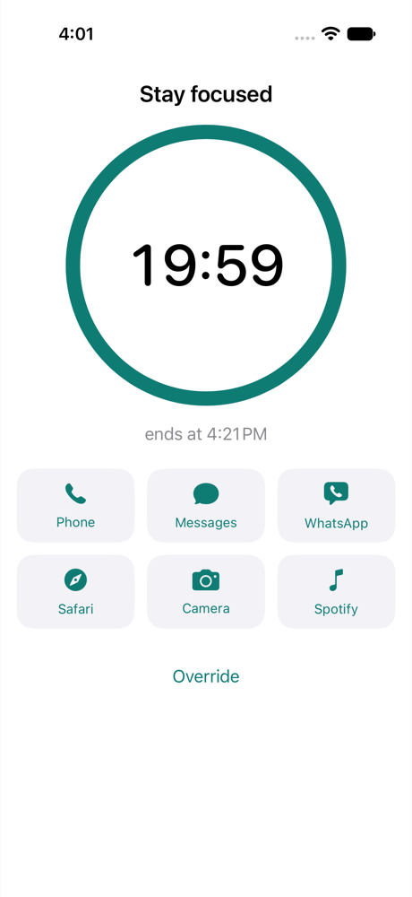
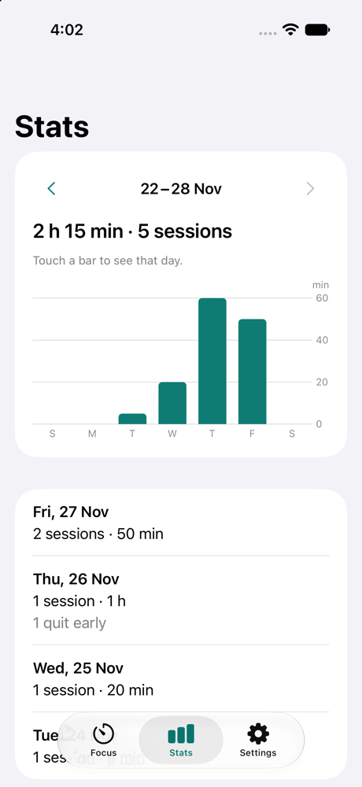

# Focus

An iPhone app for getting less distracted. Pick a length up to 2 hours, keep Phone, Messages, WhatsApp, Safari, Camera and Spotify one tap away, get reminded when you drift, and make quitting early deliberate. It does not block other apps. Everything stays on the phone, and the app makes no network requests.

**Status:** v1 built and passing in the Simulator. Not yet checked on a real iPhone ([checklist](docs/device-checks.md)).

| Home | Countdown | Stats |
|---|---|---|
|  |  |  |

## What it does

- Sessions of 1, 5, 10, 20, 30 or 60 minutes, or any length up to 2 hours.
- Reminders after about 20 seconds away, at 2 minutes, then every 5 minutes. None after one of the six buttons, a screen lock or during a call.
- A countdown on the Lock Screen and Dynamic Island.
- **Override** to quit early: 10-digit PIN, five easy sums, "are you sure", PIN again. The session is recorded as quit early.
- A week-by-week view of completed sessions and focus time.

## Install on your iPhone

Needs a Mac with Xcode, [XcodeGen](https://github.com/yonaskolb/XcodeGen) and `xcbeautify`, and a free Apple ID.

1. In Xcode, Settings, Accounts, add your Apple ID.
2. On the iPhone, turn on Developer Mode (Settings, Privacy & Security).
3. Put your team ID in `Config/Local.xcconfig` (not committed): `DEVELOPMENT_TEAM = XXXXXXXXXX`
4. Connect the iPhone, unlock it and run `scripts/install_on_phone.sh`.
5. The first time, trust the certificate in Settings, General, VPN & Device Management.

With a free Apple ID the app stops opening after **7 days**. Run the script again; history is kept.

## App guard (optional)

In the Shortcuts app: Automation, add, App, choose the distracting apps, "Is Opened", "Run Immediately", turn off "Notify When Run", then add the action **Focus Guard**. Don't choose the six allowed apps or Focus. During a session, opening a chosen app brings Focus forward.

## Tests

```bash
scripts/test.sh      # logic tests and a Simulator build
scripts/ui_test.sh   # screen tests in the "iPhone 17" Simulator
```

## Known limits

- Nothing is blocked. Force-closing the app or changing the clock is not defended against.
- After leaving through one of the six buttons, nothing reminds you, even if you move on to another app. Only the guard covers that.
- Do Not Disturb and other Focus modes hold reminders back unless Focus is allowed in them.
- Telling a screen lock from leaving needs a phone passcode and can occasionally misfire.
- The links that open Phone, Camera and Safari are unofficial and still to be checked on a phone.

## More

[Design](docs/superpowers/specs/2026-11-27-focus-design.md) · [Build plan](docs/superpowers/plans/2026-11-27-focus-v1.md) · [What iOS allows](docs/research/2026-11-27-ios-blocking-feasibility.md)
